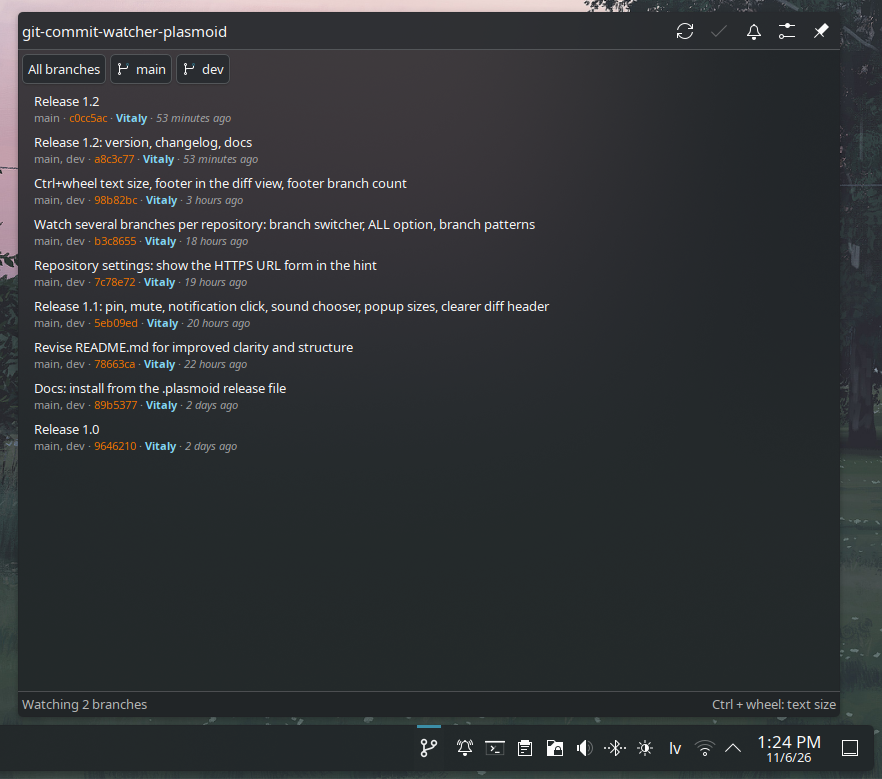
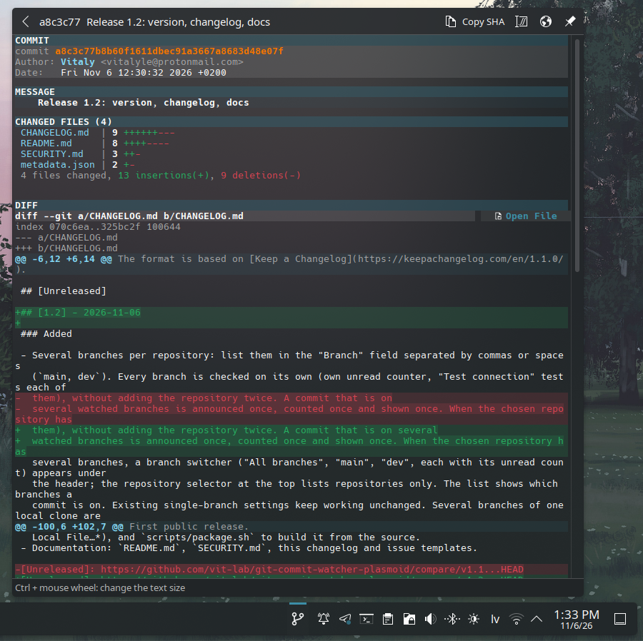
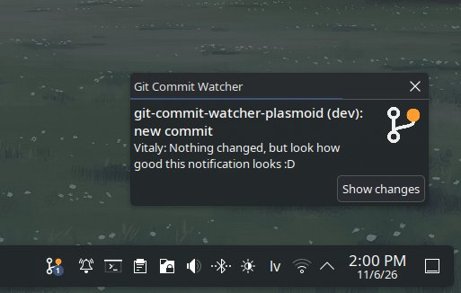
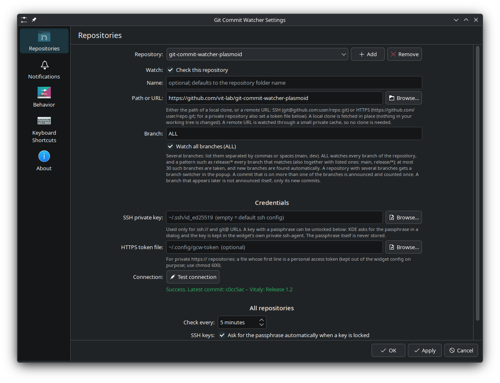
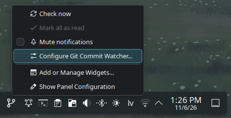

# Plasma Git Watcher

Plasma Git Watcher is a KDE Plasma 6 widget for monitoring git repositories. It shows a desktop notification
when new commits appear and displays the changes of each commit in the widget popup.

Read [SECURITY.md](SECURITY.md) before using SSH keys or tokens with the widget. The software comes with no
warranty.

## Screenshots

The commit list of a repository that is watched on several branches:



The diff view of a commit, with colored section bars, per-file statistics and "Open File" buttons:



A desktop notification about a new commit (click it to open the changes), and the panel icon with the
unread counter:



The settings of a repository, here with all branches watched (ALL):



The context menu of the widget:



## Features

- Monitoring of several repositories, either local clones or remote SSH/HTTPS URLs, each with its own branch,
  SSH key and token file. One repository can be watched on several branches (`main, dev`), on all of its
  branches (`ALL`) or on those matching a pattern (`release/*`) without adding it twice.
- Choosing what the popup shows: tick any repositories in the drop-down, and the branches of a repository in
  its "Branches" list (with a search field when there are many). Every repository name has its own color in
  the list, and the choice is remembered. With many repositories, the branch rows fold into one line.
- Search (the magnifier button or Ctrl+F) by message, author or hash, in the downloaded commits or with "All
  history" in every commit of the shown branches, and an "Advanced" row with an author filter.
- Small downloads: a repository watched by URL is kept as one small copy shared by all its branches, with only
  the recent commits and folder listings; the files of a commit are downloaded when its changes are opened.
- Light on the desktop: one check process per repository, with a low processor and disk priority, and a
  "Performance" settings page (commits shown at first, commits per branch, branches for ALL).
- Download progress (step, size, speed, time left) while a check runs, a stop button for a check that hangs,
  and a small blinking green dot on the panel icon while a check runs.
- Text size of the commit list, of the branch rows above it and of the diff view can each be changed with
  Ctrl + mouse wheel over them (remembered).
- Notifications as a single summary, one per commit, or only for the latest commit. Urgency, timeout, icon and
  sound are configurable, and the author and short hash can be shown or hidden. The sound can be a system
  sound or your own file, with a preview button.
- Clicking a notification opens the popup with the diff of that commit.
- Diff view for every commit, with a header that separates the commit data, the message, the list of changed
  files and the diff, and with colored additions, removals and hunks. The text can be selected and copied.
- An "Open File" button next to each changed file in the diff. It opens the file as it is in that commit, from
  a read-only copy.
- A "Copy SHA" button and a context menu on commits. Double-clicking a commit opens it in the browser.
- Support for passphrase-protected SSH keys through a private `ssh-agent` used only by the widget. The
  passphrase is requested in a KDE dialog and is not stored.
- HTTPS token files for private repositories.
- An unread counter on the icon, a "mark as read" action, and optional hiding in the system tray when nothing
  is new.
- A mute switch that turns off notifications and sounds while the widget keeps checking and counting. The panel
  icon shows a red crossed-out bell badge while muted.
- A pin button that keeps the popup open. The popup size is remembered separately for the commit list and
  the diff view.
- Bundled icons (idle, new commits, muted) in light and dark variants, two icon sizes, and an icon chooser for
  custom icons.
- Configuration through the settings window.

The widget only reads from repositories. It does not commit, push or change the working tree.

## Requirements

- KDE Plasma 6.0 or newer
- git
- notify-send (package `libnotify`; version 0.8 or newer is needed for "click a notification to show the
  changes")
- OpenSSH (`ssh`, `ssh-add`, `ssh-agent`, `ssh-keygen`) for SSH remotes
- kdialog, ksshaskpass or zenity for the passphrase dialog (only for keys with a passphrase)
- canberra-gtk-play or pw-play for notification sounds (optional)
- bash and common GNU utilities (`timeout`, `sha1sum`, `base64`, `find`)

The widget has been tested on Arch Linux with KDE Plasma 6 on Wayland.

## Installation

### From the KDE Store

Plasma Git Watcher is on the [KDE Store](https://www.opendesktop.org/p/2381252). In Plasma, right-click the
panel or desktop, choose "Add or Manage Widgets", then "Get New Widgets" and "Download New Plasma Widgets", and
search for "Plasma Git Watcher". The store page also offers the `.plasmoid` file for download.

### From the release package

Download `plasma-git-watcher-1.6.1.plasmoid` from the
[latest release](https://github.com/vit-lab/plasma-git-watcher/releases/latest). Use the file listed
under Assets; the automatic "Source code" archives are not installable packages.

```sh
curl -LO https://github.com/vit-lab/plasma-git-watcher/releases/download/v1.6.1/plasma-git-watcher-1.6.1.plasmoid
kpackagetool6 -t Plasma/Applet -i plasma-git-watcher-1.6.1.plasmoid
```

The package can also be installed from the widget explorer: right-click the panel or desktop, open
"Add or Manage Widgets", then "Get New Widgets" and "Install Widget From Local File".

Afterwards, add "Plasma Git Watcher" to a panel or the desktop. If the widget is not listed, restart the
shell with `systemctl --user restart plasma-plasmashell.service`. (`plasmashell --replace &` also works,
but it keeps the shell attached to the terminal, so closing the terminal ends the desktop session.)

The installed version and the checksum of the downloaded file can be checked with:

```sh
grep Version ~/.local/share/plasma/plasmoids/local.gitcommitwatcher/metadata.json
sha256sum plasma-git-watcher-1.6.1.plasmoid
```

If the release notes list a SHA-256 checksum, it should match the output of the second command.

### From source

```sh
git clone https://github.com/vit-lab/plasma-git-watcher.git
cd plasma-git-watcher
./scripts/package.sh
kpackagetool6 -t Plasma/Applet -i dist/plasma-git-watcher-*.plasmoid
```

`scripts/package.sh` creates `dist/plasma-git-watcher-<version>.plasmoid`. Do not run `kpackagetool6 -i .` in
the repository folder, because it may copy the whole repository, including `.git`, into the Plasma directory.

### Updating

Remove the installed version, install the new package and restart the shell:

```sh
kpackagetool6 -t Plasma/Applet -r local.gitcommitwatcher
kpackagetool6 -t Plasma/Applet -i plasma-git-watcher-<new version>.plasmoid
grep Version ~/.local/share/plasma/plasmoids/local.gitcommitwatcher/metadata.json
systemctl --user restart plasma-plasmashell.service
```

`kpackagetool6 -u` failed with "Plugin is not installed" when used with a `.plasmoid` file, so removal and
installation are done separately.

### Uninstalling

```sh
kpackagetool6 -t Plasma/Applet -r local.gitcommitwatcher
rm -rf ~/.cache/plasmagitwatcher
```

The second command deletes the widget's cache and is optional.

## Configuration

1. Add the widget and open its settings, page "Repositories".
2. Add a repository: the path of a local clone (for example `~/src/project`) or a remote URL
   (`git@github.com:user/project.git`, `https://github.com/user/project.git`).
3. Enter the branch to watch. For a local clone the field can stay empty, in which case the upstream branch is
   used. To watch several branches of the same repository, list them separated by commas or spaces
   (`main, dev`), tick "Watch all branches (ALL)" (or type `ALL`) to watch every branch, or use a pattern
   such as `release/*` (also together with listed branches: `main, release/*`). The branches are found
   automatically and re-checked at every check, so new branches are picked up (at most 30 branches are taken
   for ALL or a pattern; the number can be changed on the "Performance" page); a new branch is not announced itself, only its later commits. All branches of a
   repository are checked by one process, with one download per check. In the popup, a "Branches" button lets you choose which branches of such a repository are
   shown. A commit that is on more
   than one watched branch (after a merge, for example) is announced and counted once, and is listed once in
   "All repositories" with all its branches.
4. If the remote requires authentication, select an SSH key or an HTTPS token file and use "Test connection".
5. Set the check interval (5 minutes by default) and the notification options. The sound can be chosen from
   the installed system sounds or from a file ("Sound" section of the Notifications page).
6. The "Performance" page sets how much the widget downloads and shows: the number of commits the list shows
   at first (100; "Show more" at the end of the list adds the next ones, 0 shows all at once), the number of
   recent commits per branch (50) and the most branches taken for ALL or a pattern (30). "Reset to defaults"
   restores these values.

### Authentication

| Situation | Setup |
| --- | --- |
| Local clone where `git fetch` already works | No setup. The clone's own remote and the existing git and SSH configuration are used. |
| SSH key without a passphrase | Select the key file in the repository settings. |
| SSH key with a passphrase | Select the key file and press "Unlock" in the popup or the settings. A dialog asks for the passphrase and the key is loaded into the widget's private `ssh-agent`. Unlocking can happen automatically, the key can expire after a set number of hours, and "Lock" removes it. |
| HTTPS with a token | Save the token on a single line in a file readable only by you (`chmod 600`) and select it as the token file. A read-only token with minimal scope is recommended. |

Passphrases and tokens are never stored by the widget. Only the paths of the key and token files are saved.

## Usage

- With several repositories, the drop-down at the top lists them with a check box each. Tick the repositories
  you want to see; the list stays open, so several can be ticked one after another, and a click outside or
  Escape closes it. The check boxes always match what the list shows; "All repositories" ticks all of them,
  or unticks all of them when all were ticked, so you can start a new choice. When the list shows several repositories, every
  repository name has its own color, so the commits of different repositories are easy to tell apart.
- For a repository that is watched on several branches, a line below the header has a "Branches" button
  and the chosen branches next to it. The button opens the list of all branches with a check box each (and a
  search field when there are many); tick the ones you want to see, the list stays open until a click
  outside it or Escape. A click on a chosen branch in the line takes it away again; with no branch chosen,
  the line shows "All branches". The line scrolls sideways (also with the mouse wheel) when the chosen
  branches do not fit. The numbers count unread commits.
- The choice of repositories and branches is remembered.
- The magnifier button in the header (or Ctrl+F) opens a search field. Type words from the commit message or
  the author name, or the beginning of a hash (4 or more characters): the list keeps the commits that match
  all of them. Escape closes the search; closing the popup does not, so the search is still there when the
  popup opens again.
- "Advanced" next to the search field opens a second row: choose an author to see only that author's
  commits (the list has the authors of the downloaded commits), choose where the typed words are looked for
  (everywhere, message, author or hash), and "Clear" empties everything. Closing the row takes the author
  and the place back.
- The search looks through the downloaded commits (the last 50 of every branch by default). "All history"
  next to the search field, or Enter, searches every commit of the shown branches instead and lists the
  newest 200 matching commits per repository. For a repository watched by URL, the first such search
  downloads the list of all its commits, which can take a minute for a big repository.
- Clicking a commit shows its diff. The arrow at the top returns to the list.
- Double-clicking a commit opens it in the browser. Links of the form `<repository>/commit/<hash>` are used,
  which works for GitHub, GitLab and Gitea.
- Clicking a notification opens the popup. For a notification about one commit, the diff of that commit is
  shown; for a summary, the commit list of the repository. This can be switched off in the Notifications
  settings.
- The context menu of a commit has "Show the changes", "Copy SHA" and "Open in the browser".
- In the diff, text can be copied with Ctrl+C, the context menu or the copy button in the header. "Copy SHA"
  copies the full commit hash. "Open File" is shown on the header line of each changed file, except for
  deleted files.
- A middle click on the panel icon runs a check immediately. Its context menu has "Check now",
  "Mark all as read", "Mute notifications" and "Unlock SSH keys".
- The pin button in the popup header keeps the popup open when another window is focused.
- The bell button in the header (also in the context menu and in the Notifications settings) mutes
  notifications and sounds. Checking and the unread counter continue. Commits that arrive while muted are
  counted as unread but are not announced again after unmuting.
- The popup can be resized by dragging its edge. The size is remembered separately for the commit list and
  for the diff view.

## Stored data

| Data | Location |
| --- | --- |
| Settings: repository list, paths of key and token files, last seen commits, pin and mute state, popup sizes | Plasma configuration, `~/.config/plasma-org.kde.plasma.desktop-appletsrc` |
| Small copies of repositories watched by URL: the recent commits and folder listings, one copy per URL shared by its branches; file contents are downloaded only for the commits whose changes you open | `~/.cache/plasmagitwatcher/repos/` (a copy unused for 30 days is deleted) |
| Commit lists for the search in the whole history of repositories watched by URL (commits only, no folder listings or file contents), made by the first "All history" search | `~/.cache/plasmagitwatcher/history/` (a copy unused for 30 days is deleted) |
| Read-only copies created by "Open File" | `~/.cache/plasmagitwatcher/files/` (deleted after a week) |
| Socket of the private `ssh-agent` and the passphrase dialog launcher | `$XDG_RUNTIME_DIR` (`pgw-agent-<uid>.sock`, `pgw-askpass-<uid>.sh`) |
| Small lock and state files of the checks (for example the branch list of the last check), and the download progress of a running check | `$XDG_RUNTIME_DIR` (`pgw-*.lock`, `pgw-*.state`, `pgw-progress-*.txt`, and `pgw-check-<pid>.run` while a check runs), removed at logout |

## Troubleshooting

- `Permission denied (publickey)`: the server rejects the selected key. Check that the key is registered for
  the account or repository and that the correct file is selected. Running `ssh -T git@host` in a terminal
  shows the details.
- "The SSH key is protected by a passphrase and is locked": press "Unlock". If no dialog appears, install
  kdialog.
- "The current branch has no upstream branch": enter the branch name in the repository settings.
- A check hangs (for example the server does not answer): while a check runs, the refresh button in the
  header is a stop button. It ends the running checks with their git processes; press it again to start a
  new check.
- The first check of a big repository takes a while: the popup shows the progress of the download (preparing
  on the server, downloading with size, speed and the time left, unpacking). For a repository watched by URL
  only the recent commits are downloaded, without file contents, so even big repositories usually take
  seconds. A local clone is fetched by git as usual.
- "This is the oldest commit the widget has downloaded": the widget keeps only the recent history, so the
  changes of the oldest commit in its copy cannot be shown. Double-click the commit to open it in the browser.
- "Commit ... is not available locally": the diff needs the commit in the local copy. Wait for the next check
  or use "Check now".
- Clicking a notification does nothing: `notify-send --version` must be 0.8 or newer, and the notification
  server must support actions (Plasma does). The option "Clicking a notification shows the changes" must be on.
- No notifications: check that `libnotify` is installed and Do Not Disturb is off, and use "Send test
  notification" in the settings.
- The old version still appears after reinstalling: the old package was probably installed again. Check the
  version as described under "Updating" and restart the shell.
- Blank widget or QML errors: run `journalctl --user -b -g gitcommitwatcher` and include the output in an
  issue after removing private data.

## Development

```
metadata.json        plugin metadata
contents/config/     settings schema (main.xml) and settings pages (config.qml)
contents/ui/         main.qml (widget), config*.qml (settings), IconField.qml (icon chooser)
contents/code/       helpers.js and the shell scripts (check.sh, diff.sh, openfile.sh, agent.sh, askpass.sh)
contents/icons/      bundled icons (SVG)
scripts/package.sh   builds dist/plasma-git-watcher-<version>.plasmoid
```

The shell scripts are started through Plasma's `executable` data engine, and every value passed to them is
single-quoted. Structured settings (`repos`, `repoState`) are stored as JSON strings. Useful checks are
`qmllint contents/ui/*.qml` and `bash -n contents/code/*.sh`.

See [CONTRIBUTING.md](CONTRIBUTING.md) for contribution guidelines and [CHANGELOG.md](CHANGELOG.md) for the
list of changes.

## Reporting issues

Bugs and feature requests go to the [issue tracker](https://github.com/vit-lab/plasma-git-watcher/issues).
Do not include keys, tokens or passphrases. Security problems should be reported privately, as described in
[SECURITY.md](SECURITY.md). The About page of the widget also has a "Report an issue" link.

## License

GNU General Public License v3.0 or later, see [LICENSE](LICENSE). No warranty is provided, see
[SECURITY.md](SECURITY.md).
